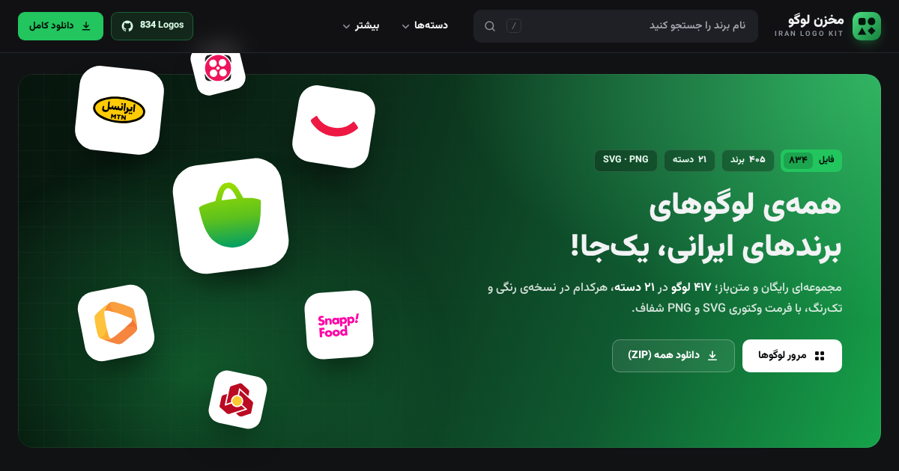

# مخزن لوگوهای ایرانی (Iran Logo Kit)

سایت استاتیک برای GitHub Pages: ۸۳۴ فایل لوگو (۴۱۷ لوگو، هرکدام رنگی و تک‌رنگ، SVG + PNG) در ۲۱ دسته، با جستجو، فیلتر و دانلود.

**نسخه‌ی آنلاین:** https://matrixteam403-hash.github.io/iran-logo-kit/

## طراحی (نسخه‌ی ۳)
- تم تیره‌ی مشکی/خاکستری با رنگ تاکید سبز، به سبک فروشگاه‌های بازی (هدر با جستجو، بنر گرادیانی، تب‌ها، کارت‌های گرد، ستون مشخصات)
- فونت فارسی **وزیرمتن** به‌صورت محلی (بدون CDN)
- هدر چسبان با جستجوی زنده و پیشنهاد نتایج؛ جستجوی فارسی هم کار می‌کند (مثلاً «دیجی کالا» ← Digikala)
- منوی کشویی دسته‌ها، منوی موبایل، دکمه‌ی بازگشت به بالا
- گالری: فیلتر دسته با شمارنده، تب رنگی/تک‌رنگ/همه، مرتب‌سازی، دانلود سریع SVG/PNG روی هر کارت
- پس‌زمینه‌ی کاشی‌ها: **خودکار** (لوگوهای تیره روی زمینه‌ی روشن نمایش داده می‌شوند تا دیده شوند)، **تیره** یا **روشن**
- صفحه‌ی هر لوگو: کاور، دانلود SVG/PNG، جدول مشخصات (حجم فایل‌ها، نسخه‌ی دیگر)، تبدیل به PNG/WebP/JPG تا ۴۰۹۶px، پیش‌نمایش روی چند پس‌زمینه و در اندازه‌های کوچک، کدهای آماده‌ی HTML/Markdown/CSS با دکمه‌ی کپی، لوگوهای مرتبط
- فیلترها در آدرس صفحه ذخیره می‌شوند (قابل اشتراک‌گذاری) و با «بازگشت» به همان نقطه‌ی گالری برمی‌گردید
- کاملاً واکنش‌گرا (موبایل تا دسکتاپ)، RTL، قابل استفاده با کیبورد (`/` برای جستجو، ← → برای لوگوی قبلی/بعدی)

## ساختار
- `index.html` – ساختار صفحه و آیکون‌ها (SVG sprite)
- `styles.css` – استایل‌ها (تم مشکی/خاکستری + سبز، RTL)
- `app.js` – منطق برنامه (vanilla JS، بدون وابستگی)
- `sw.js` / `manifest.webmanifest` – کار آفلاین و نصب به‌عنوان اپ
- `data/logos.json` – فهرست لوگوها (به‌همراه `tone`، `tint`، `svgSize`، `pngSize` برای نمایش)
- `logos/svg/` و `logos/png/` – فایل‌ها
- `download/iran-brand-logos-all-formats.zip` – پکیج کامل
- `fonts/` – فونت وزیرمتن و لایسنس آن (SIL OFL 1.1)
- `tools/analyze_logos.py` – اسکریپت تولید راهنمای نمایش لوگوها
- `og-image.png` – تصویر پیش‌نمایش برای اشتراک‌گذاری در شبکه‌های اجتماعی
- `.nojekyll` – غیرفعال کردن Jekyll در GitHub Pages

## افزودن یا تغییر لوگو
1. فایل‌های SVG و PNG را در `logos/` بگذارید و مدخل آن را به `data/logos.json` اضافه کنید.
2. اجرا کنید: `python3 tools/analyze_logos.py` (نیازمند `pip install pillow`).
   این اسکریپت برای هر لوگو مشخص می‌کند روی زمینه‌ی تیره دیده می‌شود یا نه، رنگ غالب آن را پیدا می‌کند و حجم فایل‌ها را ثبت می‌کند.

## انتشار روی GitHub Pages
1. ریپازیتوری جدید بسازید (مثلاً `iran-logo-kit`).
2. این پوشه را push کنید.
3. Settings → Pages → Source: `Deploy from a branch` → Branch: `main` / `(root)`.
4. آدرس: `https://<username>.github.io/iran-logo-kit/`

> نکته: سایت با `fetch` فهرست را می‌خواند، پس باید از طریق HTTP باز شود، نه با دابل‌کلیک روی فایل.

## لایسنس
کد و داده‌ها: MIT (طبق LICENSE). لوگوها متعلق به برندهای مربوطه‌اند. فونت وزیرمتن: SIL Open Font License 1.1.

## رنگ‌های برند
- زیتل: `#0AB5E0` (منبع: Brandfetch) · نیرو موتور: `#FF2929` و `#0D3B66` (منبع: Brandfetch)
- هلو: `#C60001` (منبع: Brandfetch) · کله: سبز و قرمز مطابق ثبت علامت تجاری
- برای سایر لوگوهای سیاه/سفید منبع معتبر رنگ پیدا نشد؛ آن‌ها بدون تغییر منتشر شده‌اند.
